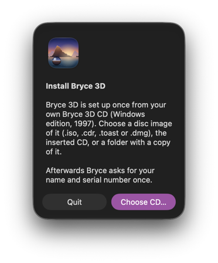
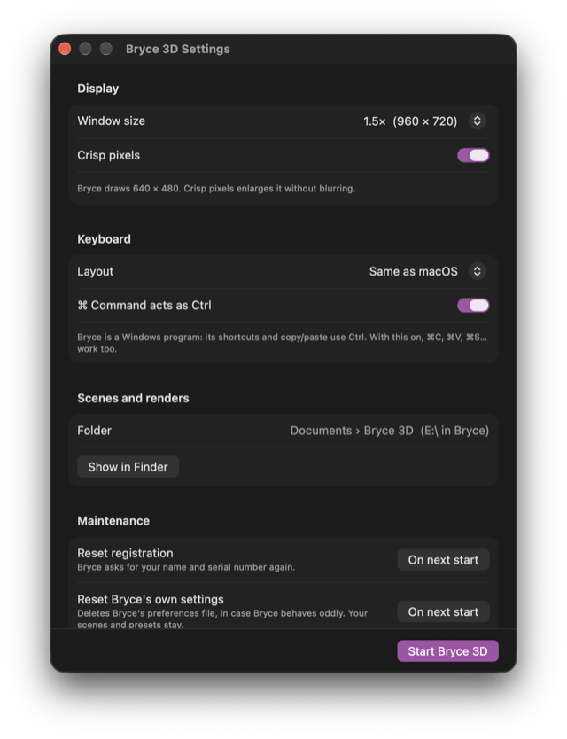

<p align="center"></p>

<h1 align="center">Bryce 3D for Apple Silicon Macs</h1>

<p align="center">Run <b>your own copy</b> of MetaCreations Bryce 3D (1997, Windows edition) as a normal Mac app.<br>
No Rosetta, Docker, Wine install or Terminal needed.</p>

<p align="center"></p>

* **Fast renders.** A scene that takes 4½ minutes in other setups renders in about 17 seconds (see [Speed](#speed)).
* **Sharp, scaled-up interface.** Bryce's 640 × 480 workspace is enlarged to fit your screen without blurring.
* **Feels like a Mac app.** Shared clipboard, your scenes in `Documents › Bryce 3D`, settings in the app menu.
* **Your CD, your serial.** Nothing from Bryce is included. The app installs Bryce from your own CD on the first start.

## What you need

* A Mac with Apple Silicon (M1 or later) and macOS 14 Sonoma or later
* Your Bryce 3D CD (Windows edition), as a disc image (`.iso`, `.cdr`, `.toast`, `.dmg`), the CD itself, or a folder with a copy of it
* Your Bryce 3D serial number
* About 4 GB of free disk space

## Install

1. Download **Bryce-3D.dmg** from the [latest release](../../releases/latest) and open it.
2. Drag **Bryce 3D** to the **Applications** folder.
3. Open Bryce 3D. The first time, macOS may say it can't verify the app: click **Done**, open **System Settings › Privacy & Security**, and click **Open Anyway** next to "Bryce 3D". (The app isn't notarized by Apple.)
4. Click **Choose CD…** and pick your Bryce 3D CD image.

   

5. Bryce is set up in a few seconds and asks for your name and serial number once.

   

   **Tip:** copy the serial number on your Mac and paste it into the field with **Ctrl+V** (or ⌘V, see [Keyboard](#keyboard)). Typing it in doesn't work: Bryce's serial field only accepts digits and a few odd characters when you type. This is an old Bryce quirk, not a problem with this app.

That's it. From now on, Bryce 3D opens straight into Bryce.

## Using Bryce 3D

### Your files

| In Bryce | On your Mac |
|---|---|
| `E:\` and `C:\Bryce3D\Projects` | **Documents › Bryce 3D** |
| `D:\` | the CD's libraries, sample scenes and tutorials |

Save scenes and export renders to **E:\\**. They appear in Documents › Bryce 3D right away, and anything you put there can be opened in Bryce. Files saved anywhere else stay inside the app's data and aren't visible in Finder.

### Keyboard

* Bryce is a Windows program: its shortcuts and copy/paste use **Ctrl** (Ctrl+C, Ctrl+V, Ctrl+S…). Turn on **⌘ Command acts as Ctrl** in Settings to use ⌘ instead.
* The keyboard follows your macOS layout and switches when you do (⌃Space). Mac and Windows/Linux layouts aren't always identical, so a few symbols may sit on different keys than on your Mac. You can pick a fixed layout in Settings.

### Clipboard

Text copied on the Mac can be pasted in Bryce, and the other way round.

### Quitting

Quit from Bryce (**File › Quit**): the window closes by itself. Closing the window or quitting the app from the Dock stops Bryce immediately, so save your scene first; the app asks before it does that.

## Settings

Open **Bryce 3D › Settings…** in the menu bar. To open them before Bryce starts (useful if Bryce doesn't start properly), **hold ⌥ Option while opening the app**.



* **Window size:** automatic (as large as fits your screen) or a fixed size.
* **Crisp pixels:** enlarges Bryce without blurring (on by default).
* **Keyboard layout** and **⌘ Command acts as Ctrl**.
* **Maintenance:**
  * **Reset registration:** Bryce asks for your name and serial number again.
  * **Reset Bryce's own settings:** if Bryce behaves oddly.
  * **Reinstall from CD:** removes the installed Bryce and asks for the CD again.
  * **Remove all Bryce 3D data:** before deleting the app.

  None of these touch your scenes in Documents › Bryce 3D.

Display and keyboard changes apply the next time Bryce starts; the settings window offers to restart it.

## Good to know

* **Speed.** Bryce renders on one processor core (it was written that way in 1997), so a render uses one core, however many your Mac has.
* **Dragging files** from Finder into the Bryce window isn't possible. Put them in Documents › Bryce 3D and open them from E:\\ in Bryce.
* **Disk space:** the app takes about 1.6 GB; Bryce and its settings about 1.5 GB more, in `~/Library/Application Support/Bryce 3D`.

## Uninstall

Open **Settings › Remove all Bryce 3D data**, then move the app to the Trash. Your scenes in Documents › Bryce 3D stay.

## Speed

Bryce 3D does all its math with the x87 floating-point instructions of 1997-era PCs. Today's Macs translate them very differently:

| Same scene, Apple Silicon Mac | Render time |
|---|---|
| **This app** (Linux VM + FEX) | **0:17** |
| BryceDock (Docker + QEMU) | 4:12 |
| Bryce under Wine + Rosetta 2 (this project's v1) | 4:34 |

Rosetta 2 handles x87 about 40× slower than modern code. This app doesn't use Rosetta at all, so it also keeps working after Apple scales Rosetta back in macOS 28.

---

## How it works

```
Bryce 3D.app  (Swift, Apple Virtualization framework, native window)
 └ small Linux VM (Ubuntu 24.04, ARM64; read-only system disk)
    ├ Xorg + Openbox, scaled with nearest-neighbour for crisp pixels
    ├ Hangover Wine (ARM64) + FEX translating Bryce's 32-bit x86 code
    │   (x87 in reduced precision: same results, since Bryce runs x87 at double precision)
    ├ input fix for Bryce's 1997 mouse handling (endless drags, Mac-style pop-up menus)
    ├ clipboard (Spice agent) and keyboard layout from macOS
    └ data disk: Bryce, its Wine setup and registration
       Documents › Bryce 3D is shared into the VM (virtiofs)
```

On the first start the VM unpacks Bryce from the CD's InstallShield archive (`data.1`) with [unshieldv3](https://github.com/wfr/unshieldv3); the 16-bit setup program never runs.

## Building from source

```
vm/build-image.sh  OUT     # Linux system image (needs Docker, ARM64)
vm/build-app.sh    OUT     # Bryce 3D.app + Bryce-3D.dmg (needs Xcode Command Line Tools)
```

The GitHub Actions workflow builds both and publishes the disk image on version tags.

Debugging: start the app from Terminal with `BRYCE_DEBUG=1 "/Applications/Bryce 3D.app/Contents/MacOS/Bryce 3D"`. The VM's console goes to `~/Library/Application Support/Bryce 3D/vm-console.log`.

## Thanks to

This app stands on the work of others. Thank you:

* **[BryceDock](https://github.com/RaymonDev/BryceDock)** by RaymonDev, which showed that Bryce 3D runs well under Wine and worked out the details: unpacking the CD's `data.1` with unshieldv3 instead of running the 16-bit installer, Openbox as the window manager, and the trick that keeps Bryce's Mac-style preset menus open on a click.
* **[Hangover](https://github.com/AndreRH/hangover)** by André Zwing and contributors: Wine for ARM64 with FEX built in, packaged ready to use.
* **[FEX](https://github.com/FEX-Emu/FEX)**, the x86 translator, and its reduced-precision x87 mode, which is what makes Bryce fast here.
* **[Wine](https://www.winehq.org)** and **[CodeWeavers](https://www.codeweavers.com)**, whose work on Wine for ARM64 with FEX pointed the way.
* **[unshieldv3](https://github.com/wfr/unshieldv3)** by Wolfgang Frisch, and **[blast](https://github.com/madler/zlib/tree/develop/contrib/blast)** by Mark Adler, for reading InstallShield 3 archives.
* **[Gcenx](https://github.com/Gcenx/macOS_Wine_builds)**, whose macOS Wine builds powered this project's first version.
* **Ubuntu** and the Debian packagers, Xorg, Openbox and spice-vdagent.
* And of course the team that made **Bryce 3D** in 1997: Kai Krause, Eric Wenger and everyone at MetaCreations.

## Licenses

* This project: [MIT License](LICENSE).
* The app contains a small Linux system (Ubuntu packages, Hangover Wine and FEX) under their own licenses (GPL, LGPL, MIT and others). The full package list with links to the source code, and a written offer for the GPL/LGPL source, is in `SOURCES.md`, attached to every release and included in the app under `Contents/Resources/Licenses`.
* Bryce 3D is © MetaCreations (now Corel). It is not included or distributed here.

See [THIRD_PARTY_NOTICES.md](THIRD_PARTY_NOTICES.md) for details.
