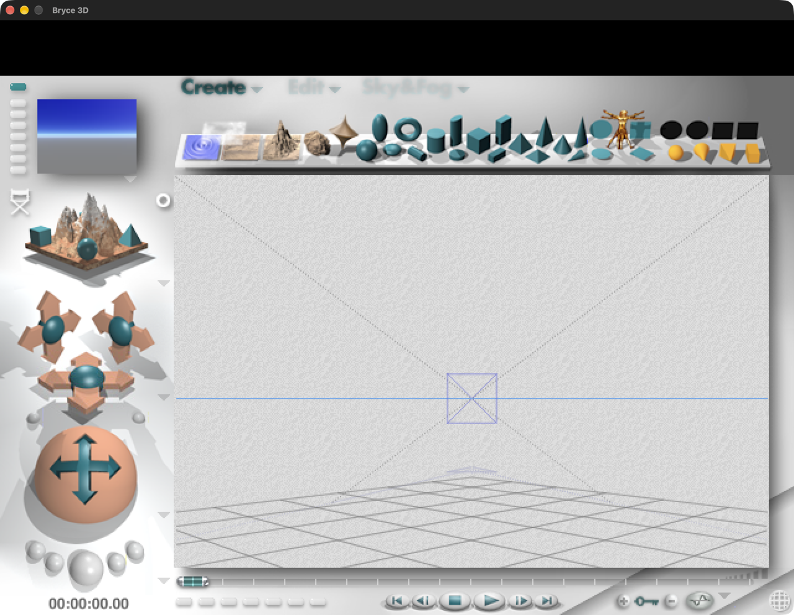
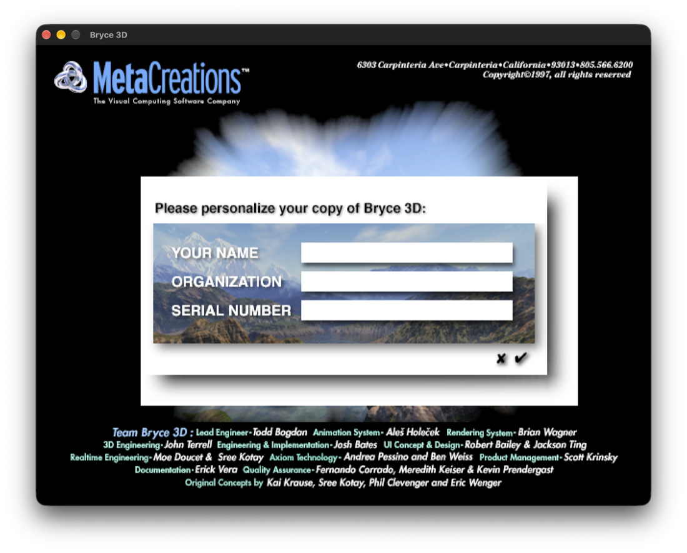

<p align="center"></p>

<h1 align="center">Bryce for Apple Silicon Macs</h1>

<p align="center">Run <b>your own copy</b> of Bryce 2, Bryce 3D or Bryce 4 (Windows editions, 1996–1999) as a normal Mac app.<br>
No Rosetta, Docker, Wine install or Terminal needed.</p>

<p align="center"></p>

* **Fast renders.** A scene that takes 4½ minutes in other setups renders in about 17 seconds (see [Speed](#speed)).
* **Sharp, scaled-up interface.** Bryce's 640 × 480 workspace is enlarged to fit your screen without blurring, or shown in full screen.
* **Feels like a Mac app.** Shared clipboard, your scenes in `Documents › Bryce`, settings in the app menu.
* **Your CD, your serial.** Nothing from Bryce is included. The app installs Bryce from your own CD on the first start.

## What you need

* A Mac with Apple Silicon (M1 or later) and macOS 14 Sonoma or later
* Your Bryce CD for Windows, **Bryce 2**, **Bryce 3D** or **Bryce 4**, as a disc image (`.iso`, `.cdr`, `.toast`, `.dmg`), the CD itself, or a folder with a copy of it
* Your serial number
* About 4 GB of free disk space (plus the size of any content CDs you add)

## Install

1. Download **Bryce.dmg** from the [latest release](../../releases/latest) and open it.
2. Drag **Bryce** to the **Applications** folder.
3. Open Bryce. The first time, macOS may say it can't verify the app: click **Done**, open **System Settings › Privacy & Security**, and click **Open Anyway** next to "Bryce". (The app isn't notarized by Apple.)
4. Click **Choose CD…** and pick your Bryce CD image. The app recognises which Bryce is on it.

   

5. Bryce is set up in a few seconds and asks for your name and serial number once.

   

   **Tip:** copy the serial number on your Mac and paste it into the field with **Ctrl+V** (or ⌘V, see [Keyboard](#keyboard)). Bryce 3D's serial field doesn't accept typed letters: an old Bryce quirk, not a problem with this app.

That's it. From now on, the app opens straight into Bryce. The window is named after the installed version.

**Upgrading from "Bryce 3D" (version 2.0.x of this app):** install the new app and delete the old "Bryce 3D" app. Your installed Bryce 3D, its registration and Documents › Bryce 3D are kept and used as they are.

## Using Bryce

### Your files

| In Bryce | On your Mac |
|---|---|
| `E:\` and the `Projects` folder next to Bryce | **Documents › Bryce** |
| `D:\` | the CD's libraries, sample scenes and tutorials |
| `F:\`, `G:\`, … | content CDs you added (see below) |

Save scenes and export renders to **E:\\**. They appear in Documents › Bryce right away, and anything you put there can be opened in Bryce. Files saved anywhere else stay inside the app's data and aren't visible in Finder.

### Content CDs

Some Bryce boxes came with extra discs: the Bryce 2 accessories CD, the Bryce 4 content CD and others with textures, materials, models and sample scenes. Add them in **Settings › Content CDs › Add CD…**: the disc is copied once on the next start and then appears in Bryce as its own drive (F:, G:, …), named after the disc. You can remove them there too.

### Keyboard

* Bryce is a Windows program: its shortcuts and copy/paste use **Ctrl** (Ctrl+C, Ctrl+V, Ctrl+S…). Turn on **⌘ Command acts as Ctrl** in Settings to use ⌘ instead.
* The keyboard follows your macOS layout and switches when you do (⌃Space). Mac and Windows/Linux layouts aren't always identical, so a few symbols may sit on different keys than on your Mac. You can pick a fixed layout in Settings.

### Mouse

* Bryce's trackballs and sliders work as on Windows: drag as far as you like, and the pointer comes back to where you started.
* Bryce's pop-up menus open with a click and stay open.

### Clipboard

Text copied on the Mac can be pasted in Bryce, and the other way round.

### Full screen

Use the green window button or **View › Enter Full Screen** (⌃⌘F). Bryce is enlarged to fill the screen while keeping its 4:3 shape, with black bars at the sides on wide screens. Window sizes that don't fit your screen open in full screen automatically.

### Bryce's hidden menus and palettes

That's Bryce, not the app: Bryce keeps its menu bar (File, Edit, Objects) and some palettes hidden until the pointer passes over them. Move the pointer to the top edge for the menus; in Bryce 2, to the right and bottom edges of the working window for the display and selection palettes.

### Quitting

Quit from Bryce (**File › Quit**): the window closes by itself. Closing the window or quitting the app from the Dock stops Bryce immediately, so save your scene first; the app asks before it does that.

## Settings

Open **Bryce › Settings…** in the menu bar. To open them before Bryce starts (useful if Bryce doesn't start properly), **hold ⌥ Option while opening the app**.


* **Window size:** automatic (as large as fits your screen) or a fixed size up to at least 2×.
* **Crisp pixels:** enlarges Bryce without blurring (on by default).
* **Keyboard layout** and **⌘ Command acts as Ctrl**.
* **Content CDs:** add or remove extra Bryce discs.
* **Maintenance:**
  * **Reset registration:** Bryce asks for your name and serial number again.
  * **Reset Bryce's own settings:** if Bryce behaves oddly.
  * **Reinstall from CD:** removes the installed Bryce and asks for a CD again. Use this to switch to another Bryce version.
  * **Remove all Bryce data:** before deleting the app.

  None of these touch your scenes in Documents › Bryce.

Window size, keyboard and maintenance changes apply the next time Bryce starts; the settings window offers to restart it.

## Good to know

* **One Bryce at a time.** The app holds one installed Bryce version. To switch, use Settings › Reinstall from CD.
* **Speed.** Bryce renders on one processor core (it was written that way), so a render uses one core, however many your Mac has.
* **Timeline playback** plays as fast as your Mac can draw the frames, much faster than real time. Bryce never timed its preview; rendered movies play at the right speed.
* **Dragging files** from Finder into the Bryce window isn't possible. Put them in Documents › Bryce and open them from E:\\ in Bryce.
* **Bryce 4 and QuickTime.** Bryce 4 saves JPEG images, QuickTime movies and QuickTime VR through QuickTime 3. The app installs it from your Bryce 4 CD (`QuickTime30.exe`) along with Bryce. These formats show up from the second start of Bryce 4 on, so quit and reopen Bryce once after registering.
* **Disk space:** the app takes about 1.6 GB; Bryce and its settings about 1.5 GB more, plus content CDs, in `~/Library/Application Support/Bryce`.

## Uninstall

Open **Settings › Remove all Bryce data**, then move the app to the Trash. Your scenes in Documents › Bryce stay.

## Speed

Bryce does all its math with the x87 floating-point instructions of 1990s PCs. Today's Macs translate them very differently:

| Same Bryce 3D scene, Apple Silicon Mac | Render time |
|---|---|
| **This app** (Linux VM + FEX) | **0:17** |
| BryceDock (Docker + QEMU) | 4:12 |
| Bryce under Wine + Rosetta 2 (this project's v1) | 4:34 |

Rosetta 2 handles x87 about 40× slower than modern code. This app doesn't use Rosetta at all, so it also keeps working after Apple scales Rosetta back in macOS 28.

---

## How it works

```
Bryce.app  (Swift, Apple Virtualization framework, native window,
 │          640 × 480 display enlarged with nearest-neighbour filtering)
 └ small Linux VM (Ubuntu 24.04, ARM64; read-only system disk)
    ├ Xorg + Openbox
    ├ Hangover Wine (ARM64) + FEX translating Bryce's 32-bit x86 code
    │   (x87 in reduced precision: same results, since Bryce runs x87 at double precision)
    ├ Bryce's windows placed by Wine itself, as on Windows, with palettes
    │   kept above their main window (bryce-xfix.so, preloaded into Wine,
    │   plus bryce-stack as a safety net)
    ├ brycefix.dll, loaded into Bryce by bryce-run.exe: Bryce draws drop shadows
    │   by copying the screen behind a dialog; Wine would return black there, so
    │   the DLL composes that area from Bryce's windows (source in vm/shim/)
    ├ input fix for Bryce's mouse handling (endless drags, Mac-style pop-up menus)
    ├ clipboard (Spice agent) and keyboard layout from macOS
    └ data disk: Bryce, its Wine setup, registration and content CDs
       Documents › Bryce is shared into the VM (virtiofs)
```

On the first start the VM unpacks Bryce from the CD's InstallShield archive (the old installers never run): `data.1` of Bryce 2 and Bryce 3D with [unshieldv3](https://github.com/wfr/unshieldv3), `data1.cab` of Bryce 4 with [unshield](https://github.com/twogood/unshield). Bryce 4's QuickTime 3 installer is 16-bit, which can't run here either, so its files are unpacked from the self-extractor and its InstallShield 3 archive the same way.

## Building from source

```
vm/build-image.sh  OUT     # Linux system image (needs Docker, ARM64)
vm/build-app.sh    OUT     # Bryce.app + Bryce.dmg (needs Xcode Command Line Tools)
```

The GitHub Actions workflow builds both and publishes the disk image on version tags.

Debugging: start the app from Terminal with `BRYCE_DEBUG=1 /Applications/Bryce.app/Contents/MacOS/Bryce`. The VM's console goes to `vm-console.log` in `~/Library/Application Support/Bryce`.

## Thanks to

This app stands on the work of others. Thank you:

* **[BryceDock](https://github.com/RaymonDev/BryceDock)** by RaymonDev, which showed that Bryce 3D runs well under Wine and worked out the details: unpacking the CD's `data.1` with unshieldv3 instead of running the 16-bit installer, Openbox as the window manager, and the trick that keeps Bryce's Mac-style preset menus open on a click.
* **[Hangover](https://github.com/AndreRH/hangover)** by André Zwing and contributors: Wine for ARM64 with FEX built in, packaged ready to use.
* **[FEX](https://github.com/FEX-Emu/FEX)**, the x86 translator, and its reduced-precision x87 mode, which is what makes Bryce fast here.
* **[Wine](https://www.winehq.org)** and **[CodeWeavers](https://www.codeweavers.com)**, whose work on Wine for ARM64 with FEX pointed the way.
* **[unshieldv3](https://github.com/wfr/unshieldv3)** by Wolfgang Frisch and **[blast](https://github.com/madler/zlib/tree/develop/contrib/blast)** by Mark Adler, for reading InstallShield 3 archives, and **[unshield](https://github.com/twogood/unshield)** by David Eriksson and contributors for the newer InstallShield cabinets.
* **[Gcenx](https://github.com/Gcenx/macOS_Wine_builds)**, whose macOS Wine builds powered this project's first version.
* **Ubuntu** and the Debian packagers, Xorg, Openbox and spice-vdagent.
* And of course the teams that made **Bryce**: Kai Krause, Eric Wenger and everyone at MetaTools and MetaCreations.

## Licenses

* This project: [MIT License](LICENSE).
* The app contains a small Linux system (Ubuntu packages, Hangover Wine and FEX) under their own licenses (GPL, LGPL, MIT and others). The full package list with links to the source code, and a written offer for the GPL/LGPL source, is in `SOURCES.md`, attached to every release and included in the app under `Contents/Resources/Licenses`.
* Bryce is © MetaTools / MetaCreations (now Corel). It is not included or distributed here.

See [THIRD_PARTY_NOTICES.md](THIRD_PARTY_NOTICES.md) for details.
